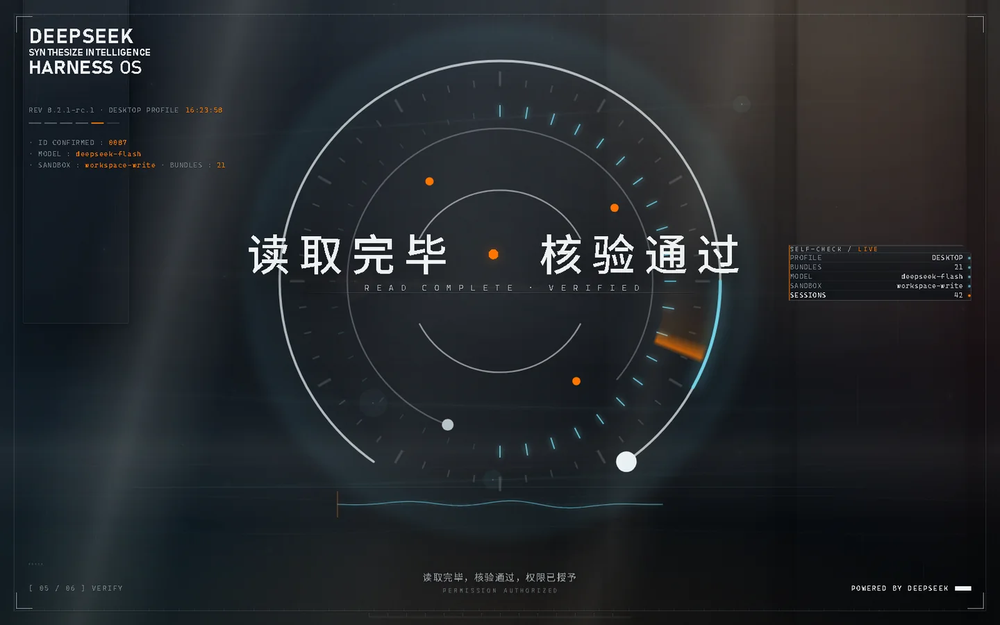

# dsh-startup-screen

DeepSeek Harness 的开机启动动画插件：**黑幕标识 → 过曝洗白 → 暖白档案底板 →
五步访问授权 → 色散故障揭幕**。不是播片，每一步都能交互、能跳过、能改文案。

当前版本 **1.6.0**：中文改用真实 500 字重并去掉逐字模糊，背景换成实时 Canvas
光场（星尘 / 贝塞尔流光 / 数据雨 / 底部水线）。

| 暗色 | 浅色 |
|---|---|
|  |  |

## 特性

- **六幕连贯序列**：厂牌标识、过曝洗白、档案底板、五步授权、揭幕，节奏由音频时长驱动。
- **可交互**：前两步要点按钮或按 Enter；右上角可跳过，Esc 也行。
- **活体背景**：Canvas 星尘与流光常驻，中心区域自动降亮，不压标题。
- **真声 + 合成双轨**：有素材用素材，缺素材自动回落 TTS / WebAudio 合成音。
- **33 项设置**：身份名称、编号、权限等级、配色、速度、音色、逐句文案，改完立即生效。
- **真数据自检**：右侧 `SELF-CHECK` 五项从宿主上下文读取，不是装饰。

## 安装

### 方式一：安装包（推荐）

1. 从 [Releases](https://github.com/QIFANAI/dsh-startup-screen/releases) 下载 `dsh-startup-screen-<版本>.tgz`。
2. **完全退出** DeepSeek Harness 桌面端（profile 由 Electron 独占）。
3. 安装并重启：

```bash
dsh plugin --profile desktop add ./dsh-startup-screen-1.6.0.tgz
dsh plugin --profile desktop list
```

### 方式二：从源码

```bash
git clone https://github.com/QIFANAI/dsh-startup-screen.git
cd dsh-startup-screen
npm --prefix package test     # 352 项冒烟断言
scripts/build.cmd             # 产出 releases/*.tgz
```

> 仓库**不附带**原片台词、原片音效与商业 BGM（原因见
> [THIRD-PARTY-NOTICES.md](THIRD-PARTY-NOTICES.md)），只保留作者自录的终幕欢迎语
> `line-6.mp3`。其余素材缺失时自动降级；想用自己的素材按
> [package/lib/assets/README.md](package/lib/assets/README.md) 放入即可。

## 目录结构

```text
├─ package/              插件源码（可编辑、可 npm pack）
│  ├─ lib/               index.js(Host) / splash.js / splash.css / client.js / assets
│  ├─ test/              4 套冒烟测试，352 项
│  ├─ preview/           离线预览页（双击 index.html 即可看）
│  └─ tools/             开发期工具（不参与打包）
├─ docs/                 截图与工程记录
├─ scripts/              build / verify / 重装
└─ THIRD-PARTY-NOTICES.md
```

## 开发

```bash
npm --prefix package test                 # 全绿才算可交付
node package/test/smoke-splash.mjs        # 单跑某一套
```

改视觉必须用无头截图核对**暗色和浅色两套**；改断言要做反向验证
（先喂一个已知缺陷，确认断言会红），防止恒真绿灯。

更多硬约束（窗口按钮归属、autoplay 策略、profile 独占）见
[docs/findings.md](docs/findings.md)。

## 兼容性

- DeepSeek Harness 桌面端（`desktop` profile）与 web profile 通用。
- 目前只在 Windows 11 + Edge/Electron 上实测；macOS/Linux 未验证。
- 中文优先 `Noto Sans SC`，回退 `PingFang SC` / `Microsoft YaHei`。

## 素材、商标与致谢

- 代码 MIT。影音素材的版权边界见 [THIRD-PARTY-NOTICES.md](THIRD-PARTY-NOTICES.md)。
- 本项目是社区作品，与 DeepSeek / 深度求索无隶属关系，未获官方背书。
- 上游插件 `dsh-startup-screen` 由 **沈宏宏** 以 MIT 发布，本仓库在其 1.1.0
  基础上持续修改，保留原始版权声明。

## License

[MIT](LICENSE) © 2026 沈宏宏（原始版本）与 dsh-startup-screen contributors（修改）
